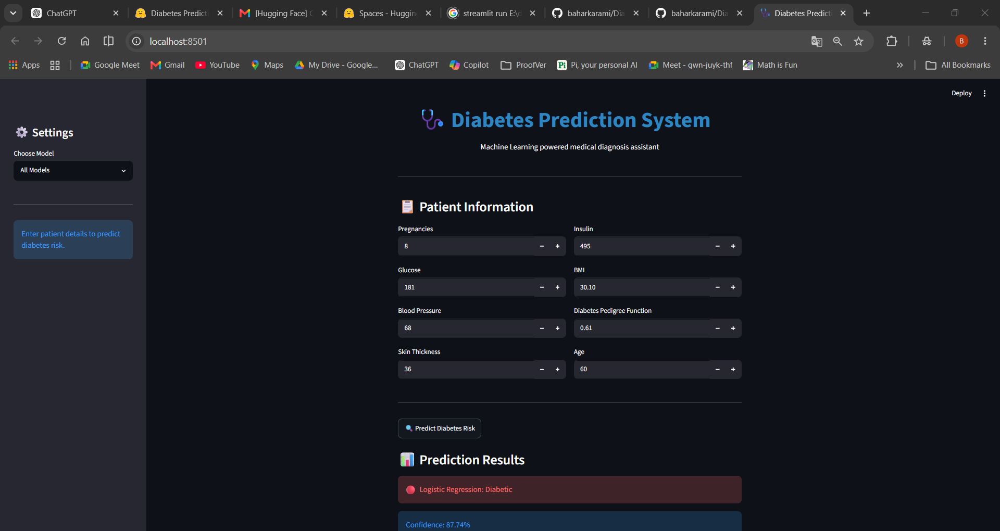

# Diabetes Prediction (Machine Learning + Streamlit)

A small end-to-end machine learning project: exploratory analysis, preprocessing, a comparison of five classifiers on the Pima Indians Diabetes Dataset, and a Streamlit app for interactive predictions.

> **Disclaimer:** This is an educational project. It is not a medical diagnostic tool and must not be used to make health decisions.

**Live demo:** https://huggingface.co/spaces/baharkarami/diabetes-prediction

<p align="center">
  
</p>

---

## What this project does

- Explores and cleans the dataset (missing values, distributions, correlations)
- Trains and compares five classification models
- Saves each trained model as a scikit-learn `Pipeline` (scaler + model) with `joblib`
- Serves the saved models in a Streamlit app where you enter patient values and see each model's prediction and predicted probability

---

## Dataset

[Pima Indians Diabetes Dataset](https://www.kaggle.com/datasets/uciml/pima-indians-diabetes-database): 768 rows, 8 numeric features, binary target.

**Features:** Pregnancies, Glucose, BloodPressure, SkinThickness, Insulin, BMI, DiabetesPedigreeFunction, Age

**Target (`Outcome`):** `0` = non-diabetic, `1` = diabetic

**Data cleaning note:** In Glucose, BloodPressure, SkinThickness, Insulin and BMI, a value of `0` is physiologically impossible and represents a missing measurement. These zeros were converted to missing values and filled with the column median. SkinThickness (227 missing) and Insulin (374 missing) are affected the most.

---

## Models and results

Data was split 80/20 with a stratified split (`random_state=10`), giving 614 training and 154 test samples. Features were standardized with a scaler fitted on the training data only.

Results on the 154 test samples (F1 is for the diabetic class):

- Logistic Regression: accuracy 0.82, F1 0.72
- Random Forest (200 trees): accuracy 0.81, F1 0.74
- Gradient Boosting: accuracy 0.79, F1 0.71
- SVM (default RBF kernel): accuracy 0.76, F1 0.63
- XGBoost: accuracy 0.75, F1 0.68

For reference, always predicting "non-diabetic" would score about 0.65 accuracy on this test set (100 of 154 samples are non-diabetic), and F1 for the diabetic class would be 0.

All models use default hyperparameters except Random Forest's `n_estimators=200`.

---

## Known limitations

These are known weaknesses I am working on. This section will shrink as they are fixed.

- **Single train/test split.** With only 154 test samples, the differences between models are small and may be within noise. Cross-validation is planned.
- **Imputation before splitting.** Median values were computed on the full dataset before the train/test split, which leaks a small amount of test information into training. The fix is to move imputation inside the `Pipeline`.
- **Missing-value handling in the app.** The models were trained on imputed data, so the app should treat `0` in the five affected fields as "unknown" rather than pass it to the model as a real value.
- **No hyperparameter tuning** and no threshold analysis. For a screening-style problem, recall and ROC-AUC matter more than accuracy and should be reported.
- **No final model selection.** The app shows all five models instead of one chosen model.
- Predicted probabilities are raw model outputs and are not calibrated.

---

## Project structure

```
diabetes-prediction/
├── streamlit_app.py        # Streamlit app
├── requirements.txt
├── README.md
├── data/
│   └── diabetes.csv
├── models/                 # saved scikit-learn pipelines (*.pkl)
├── images/
│   └── app.png
└── notebooks/
    ├── diabetes_prediction.ipynb   # EDA, preprocessing, training, evaluation
    └── diabetes_predictor.ipynb
```

---

## Run locally

```bash
git clone https://github.com/baharkarami/diabetes-prediction.git
cd diabetes-prediction

python -m venv venv
source venv/bin/activate        # Mac/Linux
venv\Scripts\activate           # Windows

pip install -r requirements.txt
streamlit run streamlit_app.py
```

Then open http://localhost:8501.

---

## Tech stack

Python, Pandas, NumPy, Scikit-learn, XGBoost, Matplotlib, Seaborn, Joblib, Streamlit

---

## Author

Bahar Karami

## License

This project is for educational purposes.
